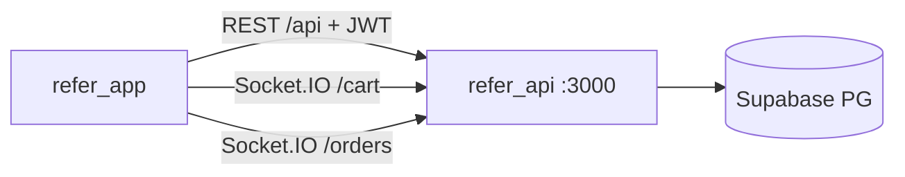

# Refer App — Cliente Flutter

App móvil de [[Refer - Idea de Negocio|Refer]] (pedidos de café artesanal + Stars). Consume [[API - Backend Go + Supabase|Refer API]] vía REST (`/api`) + Socket.IO (`/cart`, `/orders`). Sin cambios necesarios en el contrato: el backend mantiene `/api/*` intacto.

> [!abstract] Ficha rápida
> - **Repo:** `refer_app` · **Versión:** `1.0.0+1` (Dart `^3.9.2`, Flutter 3.9.2, FVM opcional)
> - **Arquitectura:** Clean Architecture por feature + BLoC + GetIt/Injectable + GoRouter
> - **API dev:** `http://127.0.0.1:3000` (Android emulator `http://10.0.2.2:3000`) · **Prod:** `https://refer-api.cobyzero.com`
> - **Tokens:** `flutter_secure_storage` (`auth_token` + `refresh_token`), Bearer en Dio
> - **i18n:** es/en (`l10n.yaml`, `app_en/es.arb`, `locale_cubit`)

## 1. Stack y dependencias (`pubspec.yaml`)

| Capa | Qué usamos |
|---|---|
| Estado | `flutter_bloc` 9.1.1 + `equatable` + `dartz` + `freezed` 3.2.5 |
| Navegación | `go_router` 17.0.1 (`lib/core/router.dart`) |
| DI | `get_it` 9.2 + `injectable` (+ generators vía `build_runner`) |
| Networking | `dio` 5.8 + `pretty_dio_logger` |
| Realtime | `socket_io_client` 2.0.3 (`/cart` carrito, `/orders` pedidos) |
| Persistencia | `flutter_secure_storage` 9.2 (tokens) + `shared_preferences` 2.5 |
| Pagos | `flutter_stripe` 12.1 (`StripeService`, PaymentIntent del backend) |
| UI | `google_fonts` 8, `flutter_svg`, `syncfusion_flutter_gauges`, `shimmer`, `cached_network_image`, `liquid_glass_widgets` (tab bar) |
| Config | `flutter_dotenv` 6 (`.env` bundled como asset), `package_info_plus` 9 (versión instalada), `url_launcher` (legales/tienda) |
| Media | `image_picker` 1.1 (foto perfil → `POST /users/upload`) |
| Tests | `flutter_test`, `patrol` 4.6, `integration_test` |



## 2. Configuración `.env` (bundled como asset)

Todo deriva de `BASE_URL` del entorno activo → `/api`, `/cart`, `/orders`. No usa `/api/v1`.

| Var | Efecto |
|---|---|
| `ENV` | `dev` / `prod` (default dev) |
| `DEV_BASE_URL` / `DEV_BASE_URL_ANDROID` | `http://127.0.0.1:3000` / `http://10.0.2.2:3000` |
| `PROD_BASE_URL` / `PROD_BASE_URL_ANDROID` | `https://refer-api.cobyzero.com` (ambas) |
| `TERMS_URL` / `PRIVACY_URL` | Links legales del auth (`refer-api.cobyzero.com/terms|privacy`) |
| `STRIPE_PUBLISHABLE_KEY` | `pk_test_...` (con fallback hardcodeado) |
| `STRIPE_MERCHANT_IDENTIFIER` | `merchant.com.example.refer_app` |

> [!warning] Android emulator
> Con API local usar `10.0.2.2:3000`, no `localhost`/`127.0.0.1`. El código lo resuelve solo vía `*_ANDROID` (`AppConstants.baseUrl` en `lib/core/constants.dart`).

## 3. Rutas GoRouter (`lib/core/router.dart`)

`initialLocation: '/'`. Sin guards declarativos: el `SplashBloc` redirige según sesión/versión.

| Ruta | Pantalla |
|---|---|
| `/` | `SplashScreen` (carga config, chequea sesión + versión) |
| `/maintenance` | `MaintenanceScreen` (servidor caído, `ServerHealth`) |
| `/update-required` | `UpdateRequiredScreen` (`minVersion` + `installedVersion` por `extra`) |
| `/auth` · `/signup` | `AuthScreen` · `SignupScreen` |
| `/forgot-password` · `/reset-password?email=` | `ForgotPasswordScreen` · `ResetPasswordScreen` |
| `/main` · `/home` (alias) | `MainNavigator` (4 tabs) |
| `/menu` | `MenuScreen` |
| `/product/:id` | `ProductDetailsScreen(productId)` |
| `/cart` · `/checkout` (`extra`: reward canjeado) · `/order-status?orderId&locationName` | `CartScreen` · `CheckoutScreen` · `OrderStatusScreen` |
| `/search` | `SearchScreen` (crea `SearchBloc` + `FetchCategories`) |
| `/order-history` · `/order-detail` (`extra`: order map) | `OrderHistoryScreen` · `OrderDetailScreen` |
| `/stars-history` (`extra`: `StarsBloc?`) | `StarsHistoryScreen` |
| `/edit-profile` · `/change-password` · `/help-center` | `EditProfileScreen` · `ChangePasswordScreen` · `HelpCenterScreen` |

Tabs (`MainNavigator`, liquid glass): Home · Stars · Orders · Settings. Al entrar hace lazy init: `HomeDataRequested` + `CartStarted` + `LocationsStarted`.

## 4. Features (`lib/features/`, 10)

| Feature | BLoC / repo | Qué hace |
|---|---|---|
| `splash` | `SplashBloc` + `AppConfigRepository` (`GET /config`) | 1) trae `AppConfig` (moneda, tax, fee, version/minVersion) 2) `PackageInfo.version` vs API (`AppVersion.status`: ok/soft/force) 3) valida sesión (`GET /auth/validate`) → `SplashAuthenticated` / `Unauthenticated` / `ForceUpdate` / `Error` (mantenimiento). Setea `Money.currencyCode`, `TaxConfig`, `ServiceFee` globales |
| `auth` | `AuthBloc` + `AuthRepository` | `POST /auth/register|login|forgot-password|reset-password|change-password`, `GET /auth/validate`, `logout` local. Tokens en secure storage; Dio añade Bearer; `401` → borra tokens |
| `home` | `HomeBloc` | Menú/catálogo: `GET /products`, `/products/categories`, `/collections`, `/dashboard/summary` |
| `product_details` | bloc propio | `GET /products/:id` + personalización (tamaño, tipo, extras/enhancements) |
| `search` | `SearchBloc` | `GET /search/*` + `GET /products/categories` |
| `cart` | `CartBloc` + `LocationsBloc` + `cart_socket_manager` | `GET/POST /cart`, `DELETE /cart/:id`, socket `/cart` (add/remove/quantity/clear); sedes `GET /locations` |
| `orders` | bloc propio | `GET /orders`, `POST /orders`, socket `/orders` (tracking Infusionando → entrega), historial + detalle |
| `stars` | `StarsBloc` | `GET /stars/balance|history|rewards|redeemed`, `POST /stars/redeem {rewardId}`, `GET /perks` |
| `settings` | — | Perfil `GET/PATCH /users/profile`, foto `POST /users/upload` (`image_picker`), `change-password`, ayuda, logout, idioma |
| `navigator` | — | Solo shell de tabs (`MainNavigator`) |

## 5. Core (`lib/core/`)

- `api_client.dart`: Dio (`baseUrl: AppConstants.apiBaseUrl`, timeouts 15s) + `PrettyDioLogger` + interceptor Bearer + `ServerHealth` (marca caído/recuperado; `401` limpia tokens).
- `constants.dart`: `AppConstants` (env/dev/prod, Android aware) + `Money` (símbolos USD/MXN/COP/CLP/ARS/CAD `$`, EUR `€`, GBP `£`, BRL `R$`, PEN `S/`) + `TaxConfig` + `ServiceFee`.
- `token_manager.dart`: `saveTokens/getAccessToken/getRefreshToken/deleteTokens/hasToken` en secure storage.
- `network/server_health.dart`: notificador global de caída → vista mantenimiento.
- `services/stripe_service.dart`: `Stripe.init` + `POST /payments/create-payment-intent {amount, currency}` → PaymentSheet.
- `utils/app_version.dart`: `AppVersion.compare` semver (sufijos `+1` ignorados) + `AppUpdateConfig.storeUri` (Play por `packageName`; iOS `iosAppId` vacío hasta publicar).
- `utils/legal_launcher.dart` (Términos/Privacidad) · `store_launcher.dart` · `icon_mapper.dart` · `responsive.dart` · `theme.dart` · `locale_cubit.dart`.
- `widgets/`: `app_snackbar`, `button_liquid_glass`, `user_avatar`. `di.dart`: registro GetIt/Injectable.
- Modelos (`core/models/` + por feature): `user`, `product`, `product_category`, `location`, cart/stars/search models (freezed + `json_annotation`).

## 6. Endpoints API que usa (verificado en `lib/`)

Auth: `POST /auth/register|login|forgot-password|reset-password|change-password`, `GET /auth/validate`. Datos: `GET /config`, `GET /dashboard/summary`, `GET /products[/:id|/categories]`, `GET /collections`, `GET /locations`, `GET /perks`, `GET /stars/balance|history|rewards|redeemed`, `POST /stars/redeem`, `GET /users/profile`, `POST /users/upload`, `GET/POST /cart`, `DELETE /cart/:id`, `GET/POST /orders`, `POST /payments/create-payment-intent`. Sockets: `/cart` + `/orders`.

> [!note] OTP email del backend
> La app hoy expone forgot/reset pero no se encontró pantalla de `verify-email`/`resend-verification` en `lib` (el API responde `403 EMAIL_NOT_VERIFIED` + `needsVerification` en registro). Si el backend exige OTP, falta UI de verificación en la app o está pendiente.

## 7. Comandos

```bash
flutter pub get            # o: fvm flutter pub get
flutter pub run build_runner build --delete-conflicting-outputs  # freezed/injectable
flutter run                # dev (ENV=dev → 127.0.0.1:3000)
flutter build appbundle --release  # Android (ENV=prod para apuntar a cobyzero.com)
flutter test
```

> [!tip] Cambiar de API
> Edita solo `.env` (`ENV=dev|prod` + `*_BASE_URL`) y re-ejecuta; está declarado como asset y se lee con `flutter_dotenv`. No hardcodear URLs.

## Referencias

- API: [[API - Backend Go + Supabase]] · Web admin: [[Web - Dashboard Admin Angular]] · Idea: [[Refer - Idea de Negocio]]
- Capturas en repo: `1.png`–`6.png` · Assets: `assets/images/` + `assets/icon/` ^referencias

> [!todo] Pendientes / vigilar
> - [ ] Confirmar UI de verificación OTP (`verify-email`/`resend-verification`) — el API la exige con `AUTOCONFIRM=false`
> - [ ] Refresh-token real (hoy `401` solo borra tokens; el comentario en `api_client.dart` lo marca pendiente)
> - [ ] Rellenar `iosAppId` al publicar en iOS (si no, solo aviso sin abrir tienda)
> - [ ] `test/` vacío — agregar tests de `AppVersion.status` y `SplashBloc`
